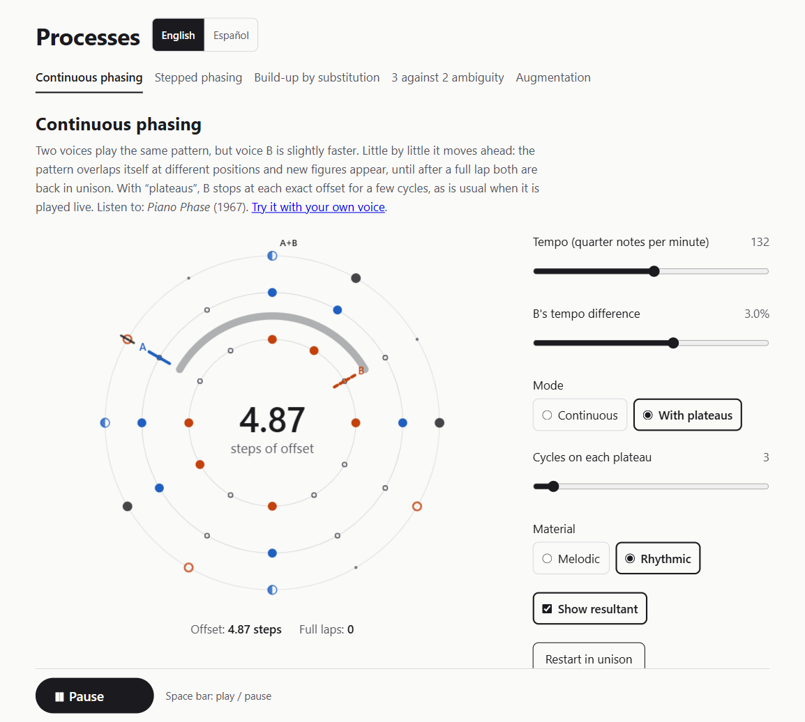

# Procesos

*[English](README.md) · Español*

App web educativa para explorar técnicas de organización del tiempo de la música de proceso: desfase continuo, desfase por saltos, construcción por sustitución, patrones resultantes, ambigüedad métrica y aumentación.

Cada módulo combina sonido generado en tiempo real, una visualización sincronizada con precisión y pocos controles: **el proceso se oye y se ve mientras sucede**.

**Pruébala:** https://luisnvb.dev/phase-lab/ — en inglés o en español (selector junto al título).



## Módulos

| Módulo | Qué muestra | Estado |
|---|---|---|
| Desfase continuo | Dos voces con el mismo patrón; una va un poco más deprisa y se separa poco a poco hasta volver al unísono. Modo continuo o con mesetas, y melodía editable. | ✅ |
| Desfase con cinta | Variante del anterior con tu propia voz: graba hasta 3 s con el micrófono (o usa un sonido de ejemplo) y escucha dos copias en bucle, una algo más rápida. | ✅ |
| Desfase por saltos | La segunda voz se adelanta un paso cada M repeticiones; una matriz muestra todas las etapas. | ✅ |
| Patrones resultantes | Capa común a los dos anteriores: qué suena cuando las voces se superponen, y escucha de solo la resultante. | ✅ |
| Construcción por sustitución | Un ciclo vacío se llena golpe a golpe (o se vacía), con una o dos voces. | ✅ |
| Ambigüedad 3 contra 2 | El mismo ciclo de 12 pulsos acentuado como 4×3, 3×4, 6×2 o 2×6, con una o dos voces. | ✅ |
| Aumentación | Sobre un pulso fijo, las notas de un acorde (editable) se alargan ciclo a ciclo y el ciclo se estira con ellas. Incluye una guía de qué escuchar. | ✅ |

Usa auriculares o altavoces estéreo: las voces suenan a cada lado.

## Compartir y exportar

- **Enlaces:** la dirección del navegador guarda siempre los ajustes del módulo (por ejemplo, `#/desfase-continuo?d=2.5&modo=plateau`), y el botón «Copiar enlace a esta configuración» la copia para compartirla. Al abrir un enlace, los valores fuera de rango se ajustan y los no válidos vuelven al valor por defecto.
- **Audio:** «Exportar audio (WAV)» genera 30 s, 1 min o 2 min del proceso con los ajustes actuales, en estéreo a 44,1 kHz. Se renderiza en el navegador, más rápido que en tiempo real, con la misma lógica que la reproducción en directo; si el proceso termina antes, el audio acaba con él.
- **Privacidad:** las grabaciones del micrófono no salen del navegador: no se envían, no se guardan y no se pueden compartir por enlace.

## Desarrollo

Requiere Node.js 22.12 o superior.

```sh
npm install
npm run dev      # servidor de desarrollo
npm test         # tests (Vitest)
npm run lint     # ESLint y comprobación de tipos
npm run build    # build de producción en dist/
```

Stack: Vite, React 18, TypeScript estricto, Web Audio API, Tone.js (solo para sintetizar los instrumentos), Canvas y SVG.

## Cómo funciona el tiempo

El reto técnico es la sincronía entre sonido e imagen con voces que tienen tempos distintos a la vez.

- **Nada suena desde un temporizador.** Un programador con ventana de antelación (`src/engine/`) agenda cada nota sobre `AudioContext.currentTime`. Cada voz lleva su propio reloj y su propio periodo.
- **Una única fuente de verdad.** Las visualizaciones no calculan el tiempo: leen la cola de eventos del motor e interpolan en `engine.now()`, ya compensado por la latencia de salida.
- **La exportación usa el mismo motor.** Para generar el WAV, cada módulo se prepara con la misma función que en directo, pero sobre un contexto de audio sin conexión y con un reloj simulado que avanza por toda la duración; Tone.js renderiza después todas las notas ya agendadas.
- **Lógica pura y testeada.** Patrones, procesos y planificación (`src/core/`) no dependen del navegador, y el motor recibe un reloj inyectable, así que los tests comprueban, por ejemplo, que con un 1 % de diferencia la voz B adelanta un ciclo completo tras 100 ciclos de A, sin `AudioContext`.

La especificación completa está en [`SPEC.es.md`](SPEC.es.md) (en inglés: [`SPEC.md`](SPEC.md)).

## Versiones

| Versión | Contenido |
|---|---|
| 0.1 | Motor de tiempo, desfase continuo (con mesetas), desfase por saltos, editor de patrones y capa de resultantes. |
| 0.2 | Construcción por sustitución y ambigüedad 3 contra 2. |
| 0.3 | Aumentación y variante con cinta del desfase continuo (grabación por micrófono). |
| 0.4 | Compartir configuraciones por URL y exportar audio en WAV. |
| 0.5 | Interfaz en inglés y español, melodía y acorde editables, guía de escucha de la aumentación. |

## Contenidos y derechos

Todo el material musical es original. La app no incluye grabaciones, partituras ni patrones transcritos de obras de Steve Reich; los textos solo citan títulos y años como referencia de escucha.

## Licencia

[MIT](LICENSE)
